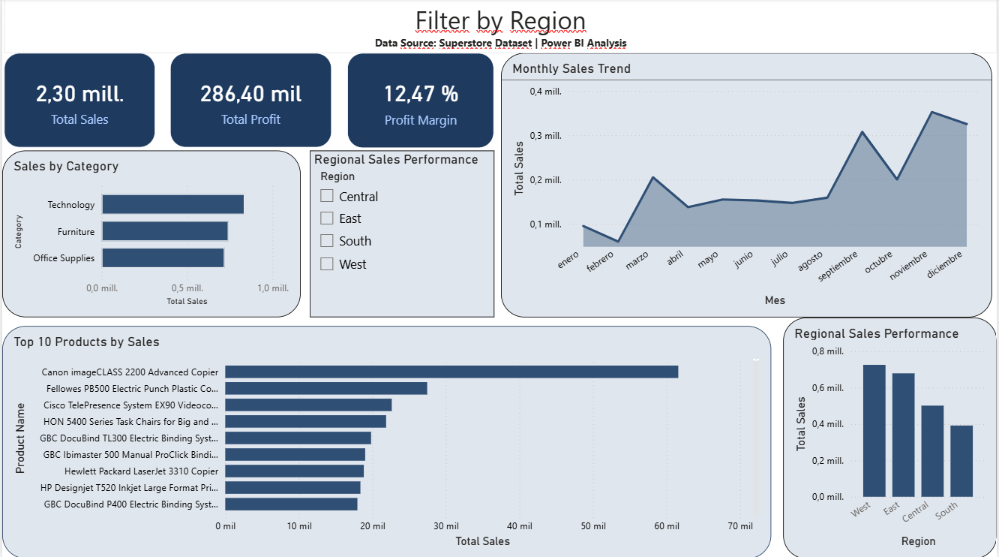

# Dashboard de ventas Superstore

Dashboard en Power BI para analizar ventas, utilidad y margen de una tienda minorista a partir del dataset Superstore.

## Contexto

Quería entender cómo se comportan las ventas y la utilidad de la tienda: qué categorías aportan más, qué regiones rinden mejor o peor y en qué meses se concentran las ventas.

## Herramientas

Power BI para el modelo y las visualizaciones, y Power Query para la limpieza y transformación de los datos.

## Dashboard

## Hallazgos

- Las ventas totales son de 2,30 millones, con una utilidad de 286.400 y un margen del 12,47 %.
- Tecnología es la categoría que más vende.
- La región Oeste lidera en ventas y la Sur es la más baja.
- Las ventas suben con fuerza en septiembre, noviembre y diciembre.
